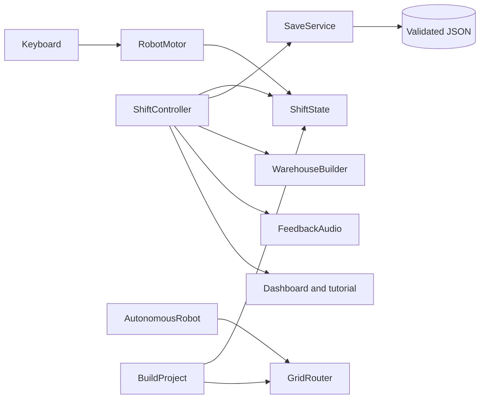

# RoboRoute — The Little Delivery Village

**Cozy visual edition:** rounded LED-face couriers, storybook cottages, a planted isometric island, colored routes, animated conveyors, delivery effects and a redesigned HUD. See [visual upgrade notes](Docs/COZY-UPGRADE.md), [screenshot](Evidence/cozy-preview.png), and [accelerated demo](Evidence/cozy-demo.mp4).

Unity 6000.3.10f1, Universal Render Pipeline. A C# warehouse simulation built from the installed Universal 3D template and the existing RoboRoute starter.

## Play

Open this folder as a project in Unity Hub. Open `Assets/RoboRoute/Scenes/Warehouse.unity` (or select **RoboRoute > Create Demo Scene** after compilation). Press Play and **Start my shift**.

WASD/arrows drive relative to the isometric camera, E picks up or delivers. Carry one package at a time. Follow the assigned bay A, B, or C; wrong bays preserve your cargo. Six FIFO jobs rotate A/B/C, each with 75 seconds from dispatch. Successful deliveries earn 100 points; expired jobs score zero and release cargo. The teal dock charges automatically. Recovery adds 30 seconds and can expire the current job. Pause freezes simulation time. Loaded cargo reduces speed.

Two autonomous couriers use grid breadth-first search around inflated storage-rack bounds and explicit pickup, delivery, and charging states. Their delivery totals are separate from the player's score. They yield to the player; robot-to-robot traffic reservations are future work.

Save/Load writes validated version-2 JSON under Unity's persistent data directory. Delivery autosaves. Load returns the player to the charger and restores player mission data; autonomous activity restarts with the scene and is not serialized. Previous version-1 starter saves are rejected. New shift does not overwrite a saved shift until another save or delivery.

## Engineering map

`ShiftState` contains serializable mission rules. `RobotMotor` handles input and collision movement. `ShiftController` coordinates interaction and the HUD. `GridRouter` uses a FIFO frontier and predecessor map: O(V+E) time, O(V) space. `AutonomousRobot` executes waypoints and state transitions. `SaveService` validates before replacing a save through a temporary file. `WarehouseBuilder` creates geometry at runtime.

## Repeatable verification

Run Unity with `-batchmode -projectPath PATH -executeMethod RoboRoute.Editor.BuildProject.Check -quit -logFile checks.log`. The command throws on a failed assertion and writes `Evidence/domain-checks.txt` on success. Covers initial state, cargo and bay rules, duplicate scoring, deadlines, completion, NaN rejection, JSON roundtrip, routes to each station, and rack clearance.

To generate the scene, run `RoboRoute.Editor.BuildProject.Setup`. To produce the Windows player, run `RoboRoute.Editor.BuildProject.Windows`. Build output: `Build/RoboRoute.exe`. The source checks are automated assertions, not a Unity Test Runner suite.

See `Docs/TESTING.md` for acceptance checks and current evidence. Do not infer runtime correctness from compilation alone.

## Three delivery stages

1. Foundation: movement, pickup, bays, score, restart, collision warehouse.
2. Engineering: FIFO timed jobs, battery, autonomous state machines, grid routing, JSON and domain checks.
3. Presentation: tutorial, dashboard, generated sound, frame-time indicator and documentation. Final visual QA, profiling, video and portfolio publication depend on verified runtime evidence.

## Portfolio discussion

Explain the difference between dispatch time and pickup time, duplicate delivery prevention, save validation, frame-independent movement and why BFS is optimal on equal-cost grids. Discuss limitations: fixed routing grid must track layout changes, custom IMGUI HUD, no robot traffic reservation, no exact world-state saves, and no save-file authentication. This is an AI-assisted prototype; understand and test it before presenting it as your own engineering work.

## Achievement edition — 28 September 2026

Eight permanent stickers, a three-page beginner tutorial, contextual action prompts, glowing destination markers, funny parcel names, personal bests and a three-star results screen are implemented. New shifts retain your collection. Open **Guide** for help or **Sticker book** to see each unlock condition.

Read [the full project report](Docs/RoboRoute-Project-Report.pdf), [one-page quick start](Docs/RoboRoute-Quick-Start.pdf), or [editable report](Docs/PROJECT-REPORT.md). Watch [the accelerated scripted demo](Evidence/achievements-demo.mp4).

Verification recorded on 11 September 2026: **118 assertions passed**, six deliveries, 600 points, zero missed jobs and zero runtime errors. Shift and career save/load roundtrips passed; the run collected seven of eight stickers. See `Evidence/achievements-integration-check.txt`. This scripted run bypasses keyboard input and is not a performance benchmark. Manual keyboard, audio and multi-resolution acceptance remain pending.

To play the Windows build, open `Build/RoboRoute.exe` with its data folder and DLLs kept alongside it. To edit, import this source folder in Unity Hub using Unity 6000.3.10f1. Read the short tutorial and choose **Let's deliver!**.
